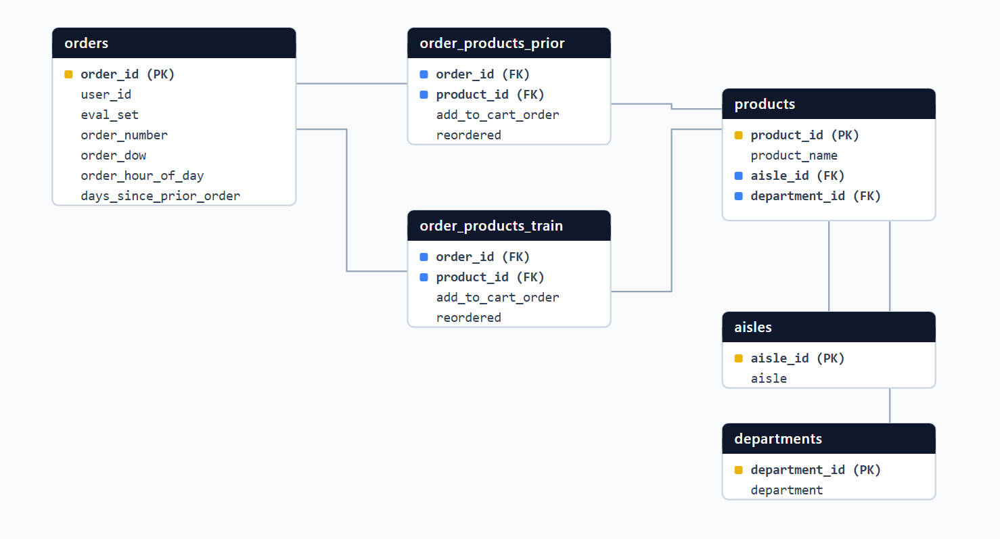
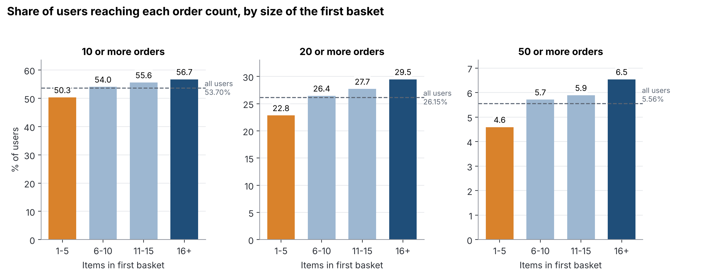
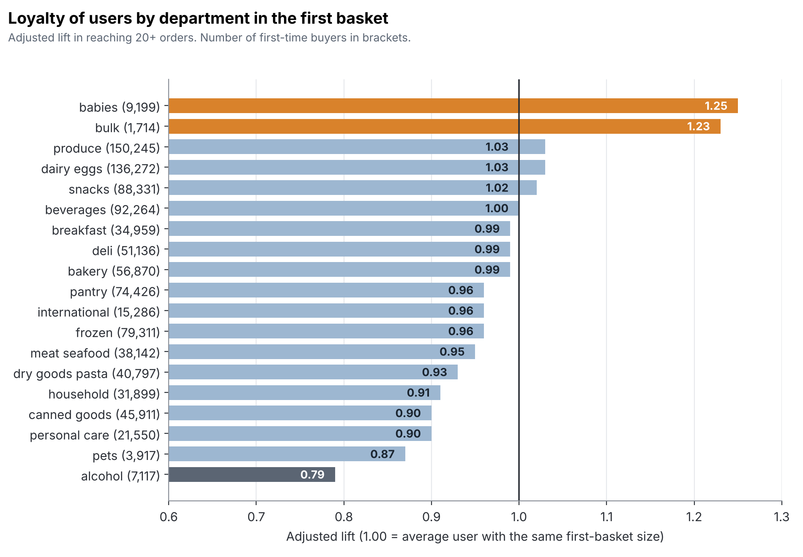
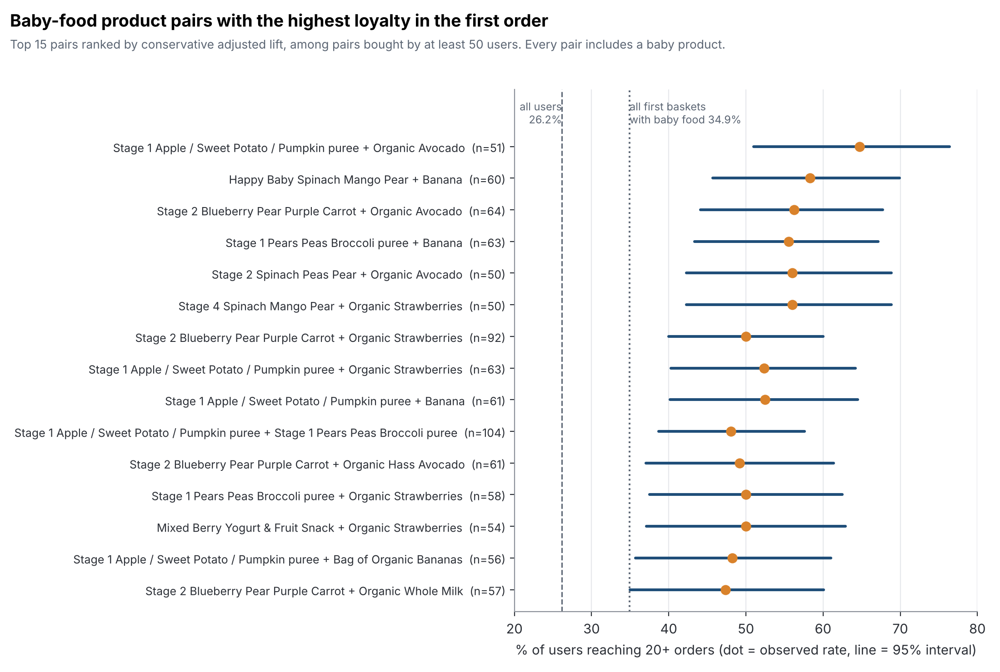
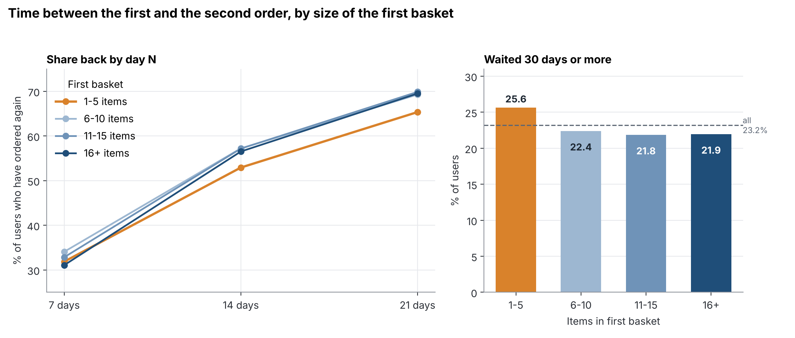

# Instacart Market Analysis

**Does the first order say anything about how long a customer keeps ordering? An SQL analysis of 3.4 million grocery orders in PostgreSQL.**


## Overview

The public Instacart Market Basket dataset has 3,421,083 orders from 206,209 users. I used it to look at one question from four directions: **what a user buys in the first order, and does it relate to how many orders they go on to place and how quickly they come back?**

The project starts from the raw CSV files and builds a PostgreSQL database with keys, indexes and data quality checks. Four analyses follow: size of the first basket, products and departments, product pairs, and the time between orders. Each script ends with its own findings and limitations.

### Key findings

1. **A bigger first basket goes with more orders, but the effect is modest.** 29.5% of users whose first basket had 16 or more items reach 20+ orders, against 22.8% of those who started with 1-5 items (all users: 26.2%). The median is 10 orders in the two smaller cohorts and 11 in the two larger ones.
2. **Individual products say more than departments.** 23 of the 25 products with the highest adjusted lift are produce or dairy, and 18 of them are organic (adjusted lift 1.25 to 1.55). At department level only babies (1.25) and bulk (1.23) stand out. Fifteen of the 19 departments sit between 0.90 and 1.03, and alcohol is the lowest at 0.79.
3. **Baby food bought together with fresh fruit goes with the highest loyalty.** In first orders that contain baby food, pairs with strawberries, avocado or banana reach 47% to 65% of users with 20+ orders, against 34.9% for all baskets with baby food. Each pair rests on 50 to 104 users, so the order inside the list is unreliable. The pattern is not.
4. **The second order is the slowest step.** 23.2% of users wait 30 days or more for it. Users who started with a small basket (1-5 items) are the slowest to come back: 25.6% wait 30 days or more, against 21.8% to 22.4% in the other cohorts. Above 5 items, a larger first basket does not bring users back sooner.
5. **All of this describes users who already came back at least three times.** The dataset only contains users with 4 to 100 orders, so these are findings about engagement among returning customers, not about churn.

## Business question and approach

| Script | Question | Main techniques |
| :-- | :-- | :-- |
| `01_Database_Setup.sql` | How do I load 37 million rows into a clean, constrained and indexed database? | DDL, bulk `COPY`, primary and foreign keys added after the load, composite index, `ANALYZE`, data quality checks |
| `02_Cohort_Retention.sql` | Is the size of the first basket associated with how many orders a user places? | CTEs, `CASE`, `ROLLUP`, `FILTER`, `FIRST_VALUE`, `PERCENTILE_CONT` |
| `03_Hero_Products.sql` | Which products and departments in the first order go with loyal users? | Materialized view, `AVG() OVER`, multi-table joins, `HAVING` |
| `04_Cross_Selling_Pairs.sql` | Which product pairs that include baby food go with the highest loyalty? | Self-join, confidence interval (Wilson) calculated in SQL |
| `05_Survival_Matrix.sql` | How quickly do users come back, and how long do they stay? | `ROLLUP`, `FILTER`, `PERCENTILE_CONT`, lower-bound estimates |

The file names come from an earlier version of the project. The header comment of each script describes what it does today.

## Dataset

The data is the Instacart Online Grocery Shopping Dataset 2017, available on [Kaggle](https://www.kaggle.com/datasets/psparks/instacart-market-basket-analysis). It is not included in this repository (see [Dataset citation](#dataset-citation-and-license)).

| Table | Rows | Content |
| :-- | --: | :-- |
| `orders` | 3,421,083 | One row per order: user, order number, day of week, hour, days since the user's previous order |
| `order_products_prior` | 32,434,489 | Products in every order except each user's last one |
| `order_products_train` | 1,384,617 | Products in the last order of a subset of users (loaded, not used in the analyses) |
| `products` | 49,688 | Product catalogue |
| `aisles` | 134 | Aisle names |
| `departments` | 21 | Department names |

Three properties of the data shape every result below:

- Every user has between 4 and 100 orders.
- There are no dates. Time only exists as `days_since_prior_order`, which is capped at 30 (a value of 30 means "30 days or more").
- There are no prices, so nothing here can be said about revenue.

## Data architecture



Relationships: `aisles` and `departments` each have many `products`. `orders` and `products` each have many rows in `order_products_prior` and `order_products_train`. The dataset has no users table, so `orders.user_id` has no foreign key.

Design decisions in `01_Database_Setup.sql`:

- **Constraints after the load.** Primary keys (composite `(order_id, product_id)` on both line tables) and foreign keys are added once the data is in. Building them in one pass is faster than maintaining them while 32 million rows are inserted.
- **One secondary index.** `orders (user_id, order_number)` serves the per-user aggregations and first-order filters. The composite primary key already covers lookups by `order_id`, and no analysis starts from `product_id`, so I did not add indexes for them.
- **A single path to edit.** The six `COPY` commands run in a loop over one `data_dir` variable, and the script drops and recreates all tables, so it can be run repeatedly.
- **Quality checks.** The script ends with 11 checks against the published figures for the dataset (row counts, 206,209 users, one `NULL` gap per user, 4 to 100 orders per user, gaps capped at 30). All 11 pass.
- **`user_summary`.** A materialized view created at the start of script 03, with one row per user: first order, first-basket size, total orders, loyalty flag and the loyalty expected for that basket size. Scripts 03, 04 and 05 read from it, so the definitions are the same everywhere.

## Repository structure

```
Instacart_Market_Analysis/
├── README.md
├── LICENSE
├── .gitignore
├── sql/
│   ├── 01_Database_Setup.sql
│   ├── 02_Cohort_Retention.sql
│   ├── 03_Hero_Products.sql
│   ├── 04_Cross_Selling_Pairs.sql
│   └── 05_Survival_Matrix.sql
├── docs/
│   └── images/               schema diagram and result charts
└── data/                     put the CSV files here (ignored by git)
```

## How the metrics are defined

- **Loyal user:** a user with 20 or more orders. Script 02 also shows 10+ and 50+ to check that the choice of 20 does not drive the result.
- **First-basket cohorts:** 1-5, 6-10, 11-15 and 16+ items in the user's first order.
- **Lift:** the rate in a group divided by the rate across all users (26.15% reach 20+ orders).
- **Adjusted lift:** the size of the first basket drives loyalty by itself (script 02), so a product that mostly appears in big baskets would look good for that reason alone. For each user I calculate how likely an average user with the same first-basket size is to be loyal. Adding that up over a product's buyers gives the expected number of loyal users, and adjusted lift is the observed number divided by it. 1.00 means no difference beyond basket size.
- **Conservative lift (pairs):** ranking many pairs by their raw rate rewards the lucky ones. Pairs are ranked by the lower end of the 95% Wilson interval of their loyalty rate, divided by the expected rate.
- **Time:** gaps below 30 days are exact. Summing gaps over several orders gives a lower bound of the real elapsed time, because every capped gap hides extra days.

## Results

### 1. First-basket size and number of orders



| First basket | Users | 10+ orders | 20+ orders | 50+ orders | Lift (20+) | Mean / median orders |
| :-- | --: | --: | --: | --: | --: | --: |
| All users | 206,209 | 53.70% | 26.15% | 5.56% | 1.00 | 16.6 / 10 |
| 1-5 items | 63,775 | 50.31% | 22.84% | 4.59% | 0.87 | 15.3 / 10 |
| 6-10 items | 63,537 | 54.04% | 26.44% | 5.71% | 1.01 | 16.8 / 10 |
| 11-15 items | 38,940 | 55.58% | 27.70% | 5.89% | 1.06 | 17.2 / 11 |
| 16+ items | 39,957 | 56.72% | 29.48% | 6.54% | 1.13 | 17.8 / 11 |

The rate rises with every step up in basket size. The biggest jump is from 1-5 to 6-10 items (+3.6 points at 20+ orders), and the steps above that are smaller (+1.3 and +1.8). Between 6-10 and 11-15 items the difference at 50+ orders (5.71% against 5.89%) is within sampling noise. The mean is far above the median, so a minority of heavy users pulls the averages up.

### 2. Products and departments



Only babies and bulk stand out, and bulk rests on 1,714 users. Even for babies, about a quarter of the raw gap (lift 1.34, adjusted 1.25) comes from bigger first baskets. Alcohol has small first baskets (9.4 items on average), but basket size does not explain its low rate: its raw and adjusted lift are both 0.79. The `missing` and `other` departments are not real categories and are excluded.

The signal is clearer at product level. The ten highest, among products with more than 1,000 first-time buyers:

| Product | Department | First-time buyers | % loyal | Adjusted lift |
| :-- | :-- | --: | --: | --: |
| Organic Large Green Asparagus | produce | 1,561 | 43.82% | 1.55 |
| Organic Milk | dairy eggs | 1,313 | 41.89% | 1.51 |
| Organic Bartlett Pear | produce | 2,039 | 42.28% | 1.49 |
| Organic Yellow Peaches | produce | 1,100 | 40.45% | 1.43 |
| Organic Red On the Vine Tomato | produce | 1,298 | 39.21% | 1.38 |
| Organic Strawberries | produce | 16,464 | 37.80% | 1.36 |
| Organic Fat Free Milk | dairy eggs | 1,460 | 37.33% | 1.35 |
| Organic Whole String Cheese | dairy eggs | 2,984 | 38.57% | 1.35 |
| Organic Reduced Fat 2% Milk | dairy eggs | 2,413 | 37.09% | 1.34 |
| Organic Large Extra Fancy Fuji Apple | produce | 3,497 | 37.49% | 1.33 |

Produce and dairy eggs as whole departments have an adjusted lift of only 1.03, so the effect belongs to specific items and a department-level view would hide it. The best supported by volume are Organic Strawberries (16,464 buyers; 37.80% loyal, raw lift 1.45, adjusted 1.36), Organic Whole Milk (7,223; 1.30) and Organic Blueberries (7,102; 1.25). Sparkling Mineral Water is the one product in the top 25 that basket size does not explain (first baskets of 9.7 items, adjusted lift 1.26), though it has only 1,101 buyers.

### 3. Product pairs with baby food



The five highest pairs by conservative lift:

| Pair | First orders | % loyal | Expected % | Adjusted lift | Conservative lift |
| :-- | --: | --: | --: | --: | --: |
| Stage 1 Apples Sweet Potatoes Pumpkin & Blueberries puree + Organic Avocado | 51 | 64.71% | 29.78% | 2.17 | 1.71 |
| Happy Baby Spinach, Mango, and Pear + Banana | 60 | 58.33% | 30.04% | 1.94 | 1.52 |
| Baby Food Stage 2 Blueberry Pear & Purple Carrot + Organic Avocado | 64 | 56.25% | 29.87% | 1.88 | 1.48 |
| Banana + Organic Pears, Peas and Broccoli Puree Stage 1 | 63 | 55.56% | 29.85% | 1.86 | 1.45 |
| Spinach Peas & Pear Stage 2 Baby Food + Organic Avocado | 50 | 56.00% | 29.67% | 1.89 | 1.43 |

Fourteen of the 15 top pairs combine a baby product with strawberries (5 pairs), avocado (4), banana (4) or organic whole milk (1). The fifteenth pairs two baby foods. Three purees appear in 11 of the 15 pairs.

Some caution is needed. Every pair comes from 50 to 104 first orders, and the baskets overlap, so the same users appear in several pairs: the 15 rows are not 15 independent findings. Part of each lift is also the effect of baby food itself. Against the 34.9% of all baskets with baby food, the pairs are 1.36 to 1.85 times higher, not the 1.62 to 2.17 of the adjusted lift.

### 4. Time to the second order and tenure



Time to the second order (exact below 30 days):

| First basket | Users | Back within 7 days | 14 days | 21 days | 30 days or more | Median days |
| :-- | --: | --: | --: | --: | --: | --: |
| All users | 206,209 | 32.58% | 55.75% | 68.21% | 23.20% | 13 |
| 1-5 items | 63,775 | 31.86% | 52.93% | 65.35% | 25.64% | 14 |
| 6-10 items | 63,537 | 34.07% | 57.22% | 69.27% | 22.38% | 12 |
| 11-15 items | 38,940 | 32.84% | 57.17% | 69.87% | 21.84% | 12 |
| 16+ items | 39,957 | 31.07% | 56.52% | 69.50% | 21.94% | 13 |

Tenure, as the share of users confirmed to have stayed at least that long (a lower bound, because capped gaps hide extra days):

| First basket | 30+ days | 60+ days | 90+ days | Median days (lower bound) |
| :-- | --: | --: | --: | --: |
| All users | 97.65% | 89.01% | 74.67% | 151 |
| 1-5 items | 97.63% | 88.93% | 73.55% | 140 |
| 6-10 items | 97.50% | 88.66% | 74.16% | 150 |
| 11-15 items | 97.79% | 89.18% | 75.63% | 160 |
| 16+ items | 97.79% | 89.51% | 76.33% | 168 |

The first return is the longest wait: the 30-day cap applies to 23.2% of second-order gaps but to about 10.7% of all later ones. The small-basket cohort stands out, while above 5 items there is no steady gradient, and in the first week the 16+ cohort is actually slower than the 6-10 cohort (31.1% against 34.1%). A reading I did not test is that users who stock up in a large first order need the next one later. Tenure rises with basket size, but only slightly, and it grows mechanically with the number of orders, so it partly restates section 1.

Read together, first-basket size goes with how many orders a user places, but its link with the speed of coming back is mostly "a small first basket is slower", not "a bigger one is faster". A reminder around day 10 to 14 for users with a small first basket would be a candidate for an A/B test. This analysis cannot say whether it would work.

## Limitations

- **Only returning users.** With 4 to 100 orders per user, anyone who left after one to three orders is missing. There is no one-time buyer, so the conversion from first to second order cannot be measured, and the results describe engagement, not churn.
- **Time is approximate.** The cap of 30 days applies to 11.49% of all gaps, and 73.72% of users have at least one capped gap. Time to the second order is exact below 30 days, tenure is a lower bound, and no analysis places later orders in exact calendar windows.
- **No prices.** Loyalty here means the number of orders. Nothing in this project measures revenue or customer lifetime value.
- **Association, not cause.** Adjusted lift only accounts for first-basket size. Household size, income and shopping intent can still explain part of the differences.
- **Small groups for pairs.** See section 3. The ranking reduces the chance of rewarding noise, but with many pairs some lucky ones remain.
- **Judgement thresholds.** 20 orders for loyalty, 1,000 first-time buyers for products and 50 first orders for pairs are choices, not properties of the data.

## Reproducing the project

**Requirements:** PostgreSQL (developed and run on version 18 with pgAdmin 4), a few gigabytes of free disk space for the database, and the six CSV files.

1. Clone the repository and create an empty database.

   ```bash
   git clone https://github.com/JoaoFelicissimo03/Instacart_Market_Analysis.git
   ```

   ```sql
   CREATE DATABASE instacart;
   ```

2. Download the dataset from [Kaggle](https://www.kaggle.com/datasets/psparks/instacart-market-basket-analysis) (a free account is needed) and unzip the CSV files into `data/`.
3. In `sql/01_Database_Setup.sql`, set the `data_dir` variable in STEP 3 to the absolute path of that folder, using forward slashes and a trailing slash. The `COPY` command is read by the PostgreSQL server, so the server process must be able to read the folder and your role needs the privilege to run server-side `COPY`. On Windows, a folder under your user profile is often not readable by the service account.
4. Run the scripts in order, from 01 to 05. With psql: `psql -d instacart -f sql/01_Database_Setup.sql`. In pgAdmin's Query Tool only the result of the last statement is shown, so run each `SELECT` on its own. Script 03 creates the `user_summary` view that 04 and 05 need.

Run times on my machine (local PostgreSQL 18, pgAdmin 4):

| Script | Run time |
| :-- | --: |
| 01 Database setup | 62.5 s |
| 02 Cohorts | 12.0 s |
| 03 Products and departments | 12.5 s |
| 04 Product pairs | 23.7 s |
| 05 Time to return | 2.4 s |
| Total | about 1 min 53 s |

## Possible next steps

- Repeat the tenure analysis on data with real timestamps and users who stop ordering, so that users who leave can be observed and censoring handled properly.
- Turn the small-first-basket idea into an A/B test design, since observational data cannot settle it.
- Build a dashboard on top of the result tables.

## Dataset citation and license

The data is not part of this repository. It is "The Instacart Online Grocery Shopping Dataset 2017", from [instacart.com/datasets/grocery-shopping-2017](https://www.instacart.com/datasets/grocery-shopping-2017). Instacart provides it as-is for non-commercial use, under its Terms and Conditions. The SQL code in this repository is released under the [MIT License](LICENSE).

## Author

João Felicíssimo

[LinkedIn](https://www.linkedin.com/in/joaofelicissimo07/) | [GitHub](https://github.com/JoaoFelicissimo03)
